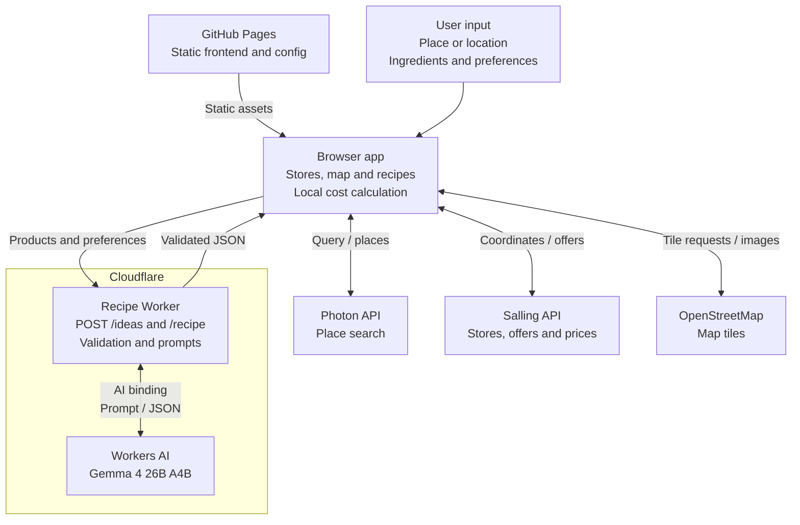

# Nærmad

**Hvad skal vi spise?** Turn nearby discounted groceries into dinner ideas.
Search an address or landmark, choose a participating Netto, føtex or Bilka,
and generate recipes in Danish or English.

**[Try Nærmad →](https://huayuansong.github.io/naermad/)**

- **Choose the ingredients, or let AI suggest dishes.** Select 1–6 products for a
  recipe, or get up to three ideas from the store's stock and develop your favourite.
- **Make it fit your kitchen.** Set portions, preparation time, vegetarian preferences
  and pantry ingredients. Recipes include explicit quantities, units and instructions.
- **See what the discounted items cost.** Totals use the store's prices and the
  required purchase quantities, with editable assumptions. Pantry items and extra
  purchases are excluded. Copy, download or print the recipe and shopping list.

## Architecture

The frontend runs in the browser, served by GitHub Pages. It fetches store data
directly and calls a Cloudflare Worker for generation. **Cloudflare Workers AI hosts
the Gemma model**; neither GitHub Pages nor the Worker runs model weights itself.



Generation happens on request: one model call for a manual recipe, or one for ideas
followed by another for the chosen recipe. Prices are calculated in the browser.
Addresses, coordinates, store names, prices and the Salling key are excluded from
the model request.

The app uses `@cf/google/gemma-4-26b-a4b-it` with structured JSON output and shared
browser/Worker validation. It has no recipe database, fine-tuned model or automatic
provider fallback. See [architecture and data flow](docs/architecture.md) for
deployment, component ownership and request limits.

## Run locally

Requires Node.js 22.12+ or a supported newer version.

```sh
npm ci
npm run dev
```

Open <http://127.0.0.1:4325/>. A fresh checkout shows labelled fictional Aarhus stores;
generation needs a configured Worker endpoint. Follow the
[setup and deployment guide](docs/setup.md) to connect live services.

To check the app:

```sh
npm test
npx playwright install chromium
npm run test:browser
npm run build
```

## Scope and documentation

Salling supplies short-dated clearance items from participating stores. Stock is
indicative, and the calculated total covers **discounted purchases only**.
AI recipes are not kitchen-tested; structural validation does not establish cooking
quality, dietary suitability or food safety.

- [Setup and deployment](docs/setup.md): configuration, Salling access and Cloudflare.
- [Architecture and data flow](docs/architecture.md): components, privacy and quotas.
- [Verification and model evaluation](VERIFICATION.md): automated checks, live trials
  and known limitations.

App code is [MIT licensed](LICENSE). External data, map tiles and models retain
their own terms.
