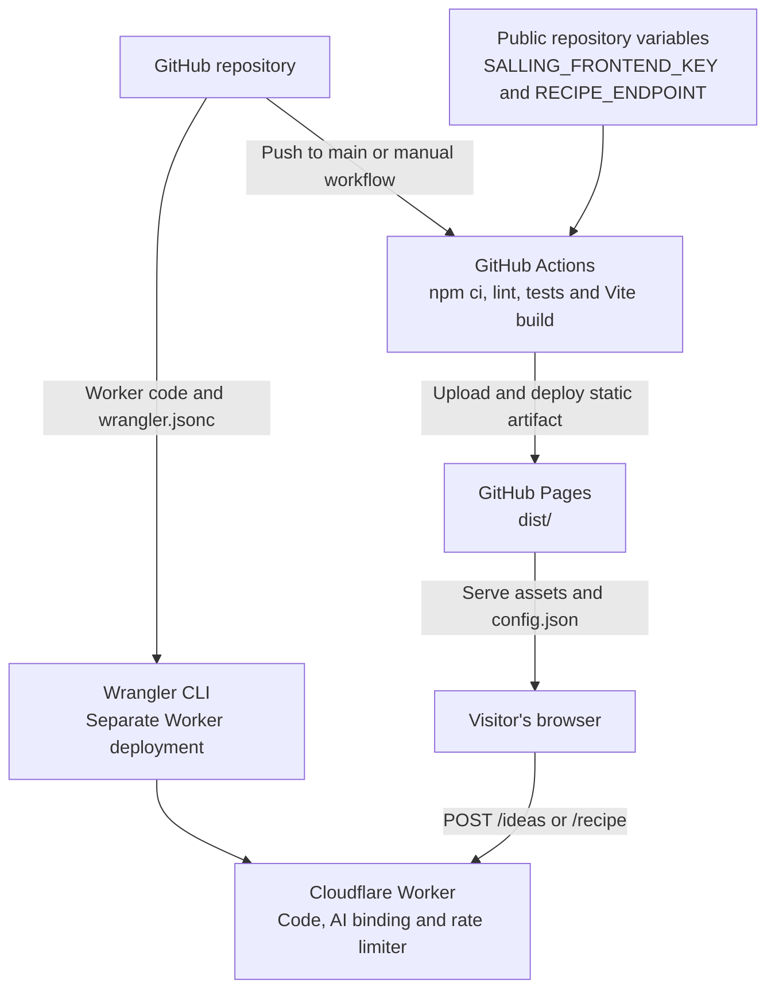

# Architecture and data flow

[Back to README](../README.md)

The [README diagram](../README.md#architecture) shows the production runtime.
GitHub Pages serves a static Vite application; the visitor's browser communicates
directly with Photon, Salling and OpenStreetMap. Only recipe generation goes through
the Cloudflare Worker, which invokes a model hosted by Cloudflare Workers AI.

## Components and source

| Component                   | Responsibility                                                                                    | Source                                                                                                                                                      |
| --------------------------- | ------------------------------------------------------------------------------------------------- | ----------------------------------------------------------------------------------------------------------------------------------------------------------- |
| Browser interface           | Search, store/product selection, loading states, language changes and recipe display              | [src/app.js](../src/app.js), [src/style.css](../src/style.css)                                                                                              |
| Data clients                | Photon search, Salling requests, in-memory caches and request coalescing                          | [src/api.js](../src/api.js)                                                                                                                                 |
| Store data                  | Validate/filter offers, normalize prices and stock, calculate straight-line distance              | [src/model.js](../src/model.js)                                                                                                                             |
| Generation client           | Build minimal request payloads, select idea candidates and call the Worker                        | [src/generation.js](../src/generation.js)                                                                                                                   |
| Cost calculation            | Match ingredient quantities to store sale units, round whole packs, calculate totals              | [src/costs.js](../src/costs.js), [src/cost-view.js](../src/cost-view.js)                                                                                    |
| Localization                | Danish/English interface, errors and browser-saved language preference                            | [src/i18n.js](../src/i18n.js), [shared/translations.js](../shared/translations.js)                                                                          |
| Cloudflare Worker           | HTTP routes, CORS, body limits, IP burst limiting and model invocation                            | [generation/worker.js](../generation/worker.js), [wrangler.jsonc](../wrangler.jsonc)                                                                        |
| Shared generation contract  | Prompts, JSON schemas, product references, quantity units and output validation in Worker/browser | [generation/contract.js](../generation/contract.js), [generation/ideas.js](../generation/ideas.js), [generation/quantities.js](../generation/quantities.js) |
| Workers AI                  | Hosted inference using `@cf/google/gemma-4-26b-a4b-it` through the Worker's `AI` binding          | [Cloudflare model documentation](https://developers.cloudflare.com/workers-ai/models/gemma-4-26b-a4b-it/)                                                   |
| Static build and deployment | Build public configuration and assets; test and publish the frontend                              | [scripts/](../scripts/), [Pages workflow](../.github/workflows/pages.yml)                                                                                   |

## From location to dinner

1. **Find a place.** Submitting a search sends the text to Photon, which returns
   matching Danish places and coordinates. Alternatively, browser geolocation
   supplies coordinates after permission; it bypasses Photon.
2. **Fetch nearby stock.** Choosing a place sends coordinates and radius to Salling's
   `GET /v1/food-waste/` using an origin-restricted frontend key. The response includes
   store metadata and clearance offers, so no separate Stores API call is needed.
   The browser filters invalid, expired and sold-out offers and unsupported brands.
   Leaflet displays the locations over OpenStreetMap tiles.
3. **Choose how to generate.** Manual mode sends 1–6 selected products to `POST /recipe`.
   Inspiration sends up to 60 unique, unexpired product names to `POST /ideas`,
   returning up to three dish outlines. Choosing an outline makes a separate
   `POST /recipe` request with its products, title, description and expected extras.
   Larger inventories rotate through another bounded selection when requesting
   new ideas; this is not an exhaustive inventory search.
4. **Generate and validate.** The Worker validates input, applies its rate limiter,
   constructs the prompt/schema and calls `env.AI.run()` once. Thinking is explicitly
   disabled. It validates the model response and normalizes quantities into Danish
   or English display strings. The browser validates the response again. Current
   prompt versions are `naermad-generated-v6` and `naermad-ideas-v2`.
5. **Calculate and display.** The browser joins ingredient references to the fetched
   offer snapshot and computes purchase costs locally. The recipe, cost breakdown
   and shopping list can be copied, downloaded or printed.

The model can decline unsuitable inputs. Invalid output, provider failures and
exhausted quotas produce explicit messages; there are no automatic retries or
catalogue recipes. Store, product, preference and language changes invalidate old
results and cancel pending browser requests. Cancellation cannot guarantee that
upstream inference has stopped consuming allowance.

The unused Hugging Face adapter is a manually configured alternative, not a fallback
or part of the deployed path. No fine-tuning dataset, training job, vector database
or recipe retrieval service is used by this application.

## Cost calculation

Prices come from Salling, independently of the model. The displayed total covers
only discounted products needed from the chosen store, excluding pantry items and
extra ingredients.

- Compatible quantities are matched to explicit pack sizes. For example, 600 g from
  400 g packs at 25 kr. requires two packs and costs 50 kr. References to the same
  product are combined before rounding; weight-priced items use kilograms.
- Unmatched each-priced quantities assume one sale unit and are labelled estimated.
  Unknown weight quantities or price units remain unpriced, producing a subtotal.
  Users can edit purchase quantities without another API or model request.
- Suggestion cards have no recipe quantities yet, so their preview is explicitly a
  one-of-each basket. Low indicated stock is flagged.

Neither quantity validation nor price arithmetic verifies that a recipe makes
culinary sense. The app does not infer ingredient density, grams per piece or
cooked/drained weights.

## Deployment

The Pages workflow publishes pushes to `main` and can also be run manually.
It runs lint, unit tests, browser tests and the Vite build before deploying `dist/`.
It does **not** deploy the Worker. Worker changes require a separate Wrangler
deployment; changing the model or prompt also requires live output review.

Build scripts merge [public/config.json](../public/config.json) with environment
overrides. Everything written to `dist/config.json` is public. The Salling key is
specifically a Frontend / Website App key; private credentials never belong there.
See [setup](setup.md) for configuration and deployment commands.

## Data boundaries and storage

| Recipient                        | Data received from the app                                                                                                                       |
| -------------------------------- | ------------------------------------------------------------------------------------------------------------------------------------------------ |
| Photon                           | Explicitly submitted place/address search text                                                                                                   |
| Salling                          | Selected coordinates, search radius and public frontend credential                                                                               |
| OpenStreetMap tile service       | Requested map tile coordinates                                                                                                                   |
| Generation Worker and Workers AI | Product names with temporary IDs, pantry items, portions, time, vegetarian preference, language and variant; chosen idea details when applicable |

The generation payload excludes address, coordinates, store name, prices and the
Salling key. Providers still receive network metadata. The Worker uses the client
IP for rate limiting; CORS is a browser restriction, not authentication.

There is no application database, visitor account, analytics or saved address
history. Search results, offers and recipes live in browser memory; only the
language preference is stored in localStorage. Worker application logs contain
event, provider, model, result status and token counts, not prompt/recipe text or
credentials. Logs are sampled at 10%, traces at 1%, and invocation logs are disabled.

## Capacity and limitations

Provider limits below were checked on **1 November 2026**; confirm current terms
before relying on them for capacity.

| Resource                   | Current limit or behavior                                                                        |
| -------------------------- | ------------------------------------------------------------------------------------------------ |
| Salling Anti Food Waste    | 100 requests/day; up to 20 stores per nearby response                                            |
| Workers AI on Workers Free | 10,000 neurons/day shared by the account; resets at 00:00 UTC                                    |
| App burst limiter          | Approximately 3 AI requests/minute per IP per Cloudflare location, shared across both routes     |
| Recipe request             | 12,000-byte body; 1–6 products; up to 2,400 output tokens                                        |
| Ideas request              | 64,000-byte body; up to 60 products; up to 1,600 output tokens                                   |
| Preferences                | 1–6 servings, 20/30/45/60 minutes, up to 16 pantry items                                         |
| Store cache                | Five minutes per coordinates/radius in each browser tab; identical in-flight requests are pooled |

Sources: [Salling quotas](https://developer.sallinggroup.dev/apireference/quota),
[nearby-store API](https://developer.sallinggroup.dev/apireference/food-waste),
[Workers AI pricing](https://developers.cloudflare.com/workers-ai/platform/pricing/).

The latest two full-recipe checks imply about 28–29 neurons per recipe. A practical
planning estimate is **300–350 similar recipes/day**, or around **200 sessions**
consisting of ideas plus one recipe, assuming a fresh allowance and no other account
usage. These are small-sample extrapolations, not load-test results or guaranteed
capacity; longer responses consume more. Earlier 370–500 estimates used a shorter
prompt. See [the latest quantity checks](../VERIFICATION.md#explicit-ingredient-units).

All visitors share the provider allowances. Changing stores within a fetched result,
editing costs or switching languages needs no new stock request. There is no
background stock polling; a local timer removes expired offers. The configured
Workers Free plan stops inference at its daily allowance. A paid account can incur
overage charges, so the free-only behavior depends on the account plan.

Salling covers short-dated clearances rather than all weekly promotions or all
Danish chains. Stock is indicative, the store list can be capped, and distances
are straight-line distances. Photon and public map tiles have their own
[fair-use](https://github.com/komoot/photon) and
[tile-use](https://operations.osmfoundation.org/policies/tiles/) policies.

Automated checks establish app behavior and structured-output contracts; they do
not establish recipe quality, dietary compliance or food safety. See
[verification](../VERIFICATION.md) for the exploratory model comparison and live checks.
